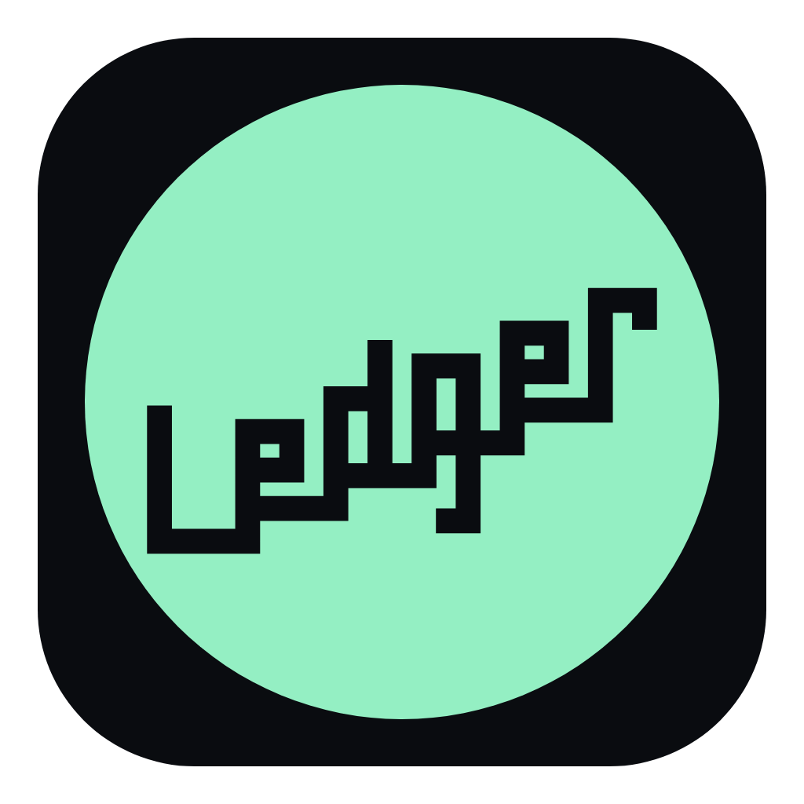
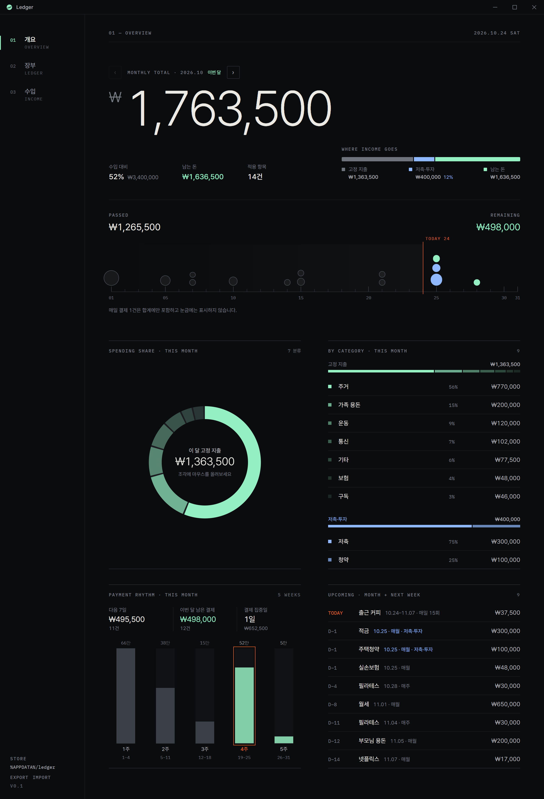

#  Ledger

## 🚀 Overview

Windows **Electron + React + Vite** 기반의 **오프라인 고정비 · 저축 가계부**입니다.  
월세 · 통신비 · 구독 같은 고정비와 적금 · 청약 같은 저축을 주기별로 등록하고, 세트로 묶어 달마다 적용하면 이번 달 총액 · 수입 대비 · 남는 돈을 한 화면에서 보여 줍니다. 데이터는 서버 없이 내 PC(`%APPDATA%`)에만 저장합니다.

## 🛠️ Built With

<picture>
  <source media="(prefers-color-scheme: dark)" srcset=".github/readme/badges/dark/windows.png">
  <source media="(prefers-color-scheme: light)" srcset=".github/readme/badges/light/windows.png">
  
</picture>
<picture>
  <source media="(prefers-color-scheme: dark)" srcset=".github/readme/badges/dark/electron.png">
  <source media="(prefers-color-scheme: light)" srcset=".github/readme/badges/light/electron.png">
  
</picture>
<picture>
  <source media="(prefers-color-scheme: dark)" srcset=".github/readme/badges/dark/react.png">
  <source media="(prefers-color-scheme: light)" srcset=".github/readme/badges/light/react.png">
  
</picture>
<picture>
  <source media="(prefers-color-scheme: dark)" srcset=".github/readme/badges/dark/typescript.png">
  <source media="(prefers-color-scheme: light)" srcset=".github/readme/badges/light/typescript.png">
  
</picture>
<picture>
  <source media="(prefers-color-scheme: dark)" srcset=".github/readme/badges/dark/vite.png">
  <source media="(prefers-color-scheme: light)" srcset=".github/readme/badges/light/vite.png">
  
</picture>

## 🖥️ Preview

<p align="center">
  
</p>

## ✨ Key Features

- **📅 주기별 고정비**: 매일 · 매주(요일) · 매월(날짜) · 분기 · 연간 납부를 등록하고 월 환산 금액으로 비교
- **🗂️ 세트 · 월 적용**: 항목을 세트로 묶어 달마다 적용 — 적용한 달만 개요 · 수입 합계에 반영
- **📊 개요**: 이번 달 총액(고정 지출 + 저축 · 투자), 수입 대비 · 남는 돈, 날짜 눈금, 분류 도넛, 주간 결제 리듬, 다가오는 결제
- **🏦 저축 · 투자 분리**: 저축 · 투자 · 연금 · 청약은 고정 지출과 따로 집계하고 저축률을 표시
- **💰 수입**: 기본 월수입 + 달별 덮어쓰기, 달별 지출 · 저축 막대, 연간 합계, 월별 흐름 차트 (세트 미적용 달은 합계에서 제외)
- **💾 오프라인 로컬 저장**: 원자적 쓰기 · 직전본(`.bak`) · 날짜별 백업 14개, 읽을 수 없는 파일은 덮어쓰지 않고 보관
- **📤 JSON 내보내기 / 가져오기**: 장부 전체를 파일로 옮기거나 백업에서 복구 (가져오기 창은 백업 폴더에서 열림)

## 📂 Project Structure

```text
MINI_Ledger/
┣━━ 📂 .github/readme/          # README 에셋 (logo, preview, badges)
┣━━ 📂 assets/                  # 앱 아이콘 · 폰트 (Pretendard, IBM Plex Mono)
┣━━ 📂 electron/
┃   ┣━━ main.ts                 # 창 · IPC · 내보내기/가져오기 · 확인 대화상자
┃   ┣━━ preload.ts              # window.ledger / windowControls 브리지
┃   ┗━━ store.ts                # JSON 저장소 (원자적 쓰기 · .bak · 날짜별 백업)
┣━━ 📂 scripts/                 # Electron 번들(esbuild) · 아이콘 렌더
┣━━ 📂 src/
┃   ┣━━ Overview.tsx            # 개요
┃   ┣━━ LedgerPage.tsx          # 장부 (작업대 · 세트 · 월 적용)
┃   ┣━━ IncomePage.tsx          # 수입 · 월별 흐름 차트
┃   ┣━━ 📂 overview/            # 날짜 눈금 · 분류 · 결제 리듬 · 다가오는 결제
┃   ┣━━ 📂 ledger/              # 입력 폼 · 납부 시점 선택 · 세트 작업대 훅
┃   ┣━━ schedule.ts             # 주기별 납부일 · 월 합계 · 지출/저축 집계
┃   ┣━━ ledgerData.ts           # 정규화 · 마이그레이션 · 세트 규칙 (store와 공용)
┃   ┣━━ devMock.ts              # 브라우저 개발용 샘플 데이터
┃   ┗━━ 📂 styles/
┣━━ 📄 package.json
┗━━ 📄 README.md
```

## ⚙️ Getting Started

### 📋 Prerequisites (사전 요구사항)

- **OS**: Windows 10 / 11
- **Node.js**: 개발 · 빌드용

### 1. 소스에서 실행 (Develop)

```bash
# 1. 저장소 클론
git clone https://github.com/Hyeonseok93/MINI_Ledger.git
cd MINI_Ledger

# 2. 의존성 설치
npm install

# 3. 개발 실행 (Vite + Electron)
npm run dev
```

Electron main / preload는 TypeScript이며 `npm run build:electron`(esbuild)으로 `electron/*.cjs`를 만듭니다.  
브라우저로 `http://127.0.0.1:5173`만 열면 `window.ledger` 대신 **샘플 데이터 목업**으로 화면이 뜹니다 (새로고침 시 초기화).

### 2. 실행 파일 빌드 (Build)

```bash
npm run build:exe
```

출력: `release/win-unpacked/Ledger.exe`

> 💡 **폴더 전체**를 배포하세요. `.exe`만 복사하면 Electron 런타임 DLL이 없어 실행되지 않습니다.  
> 코드 사이닝은 설정되어 있지 않아, 첫 실행 시 SmartScreen 경고가 날 수 있습니다.

## ⚠️ Limits

- **고정비 장부**입니다. 카드 · 은행 내역 연동이나 변동 지출 기록은 없습니다.
- 세트를 **적용한 달만** 합계에 들어갑니다. 적용하지 않은 달은 수입 화면에 `세트 미적용`으로 표시되고 연간 합계에서 빠집니다.
- 저장소는 **이 PC 한 곳**입니다. 동기화가 없고 날짜별 백업도 같은 디스크에 남으므로, 다른 곳에 보관하려면 Export를 쓰세요.
- Windows 기준으로 빌드 · 확인했습니다.

## 💾 Persistence paths

| Runtime | Location |
|---------|----------|
| Electron (dev / exe) | `%APPDATA%/ledger/store/ledger.json` |
| 직전본 | `%APPDATA%/ledger/store/ledger.json.bak` (저장할 때마다 이전 내용) |
| 날짜별 백업 | `%APPDATA%/ledger/store/backups/ledger-YYYY-MM-DD.json` (그날 첫 저장 전 상태, 최근 14개) |
| 손상 파일 보관 | `%APPDATA%/ledger/store/ledger.corrupt-<시각>.json` (읽을 수 없을 때, 이후 저장 차단) |
| Vite 브라우저 | 메모리 샘플 데이터 (저장 안 함) |

## 🧪 Tests

```bash
npm test          # Vitest — 주기 계산 · 세트 규칙 · 저장소(원자적 쓰기 · 백업 · 복구)
npm run build:web # tsc + vite build
```

## 📄 License

This project is licensed under the MIT License.
